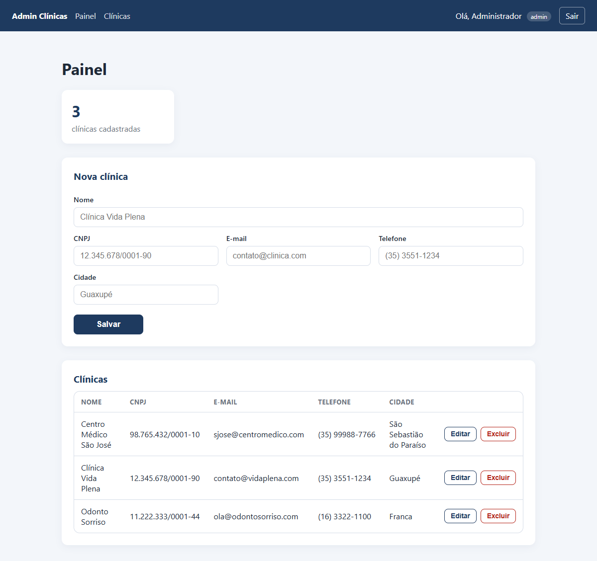
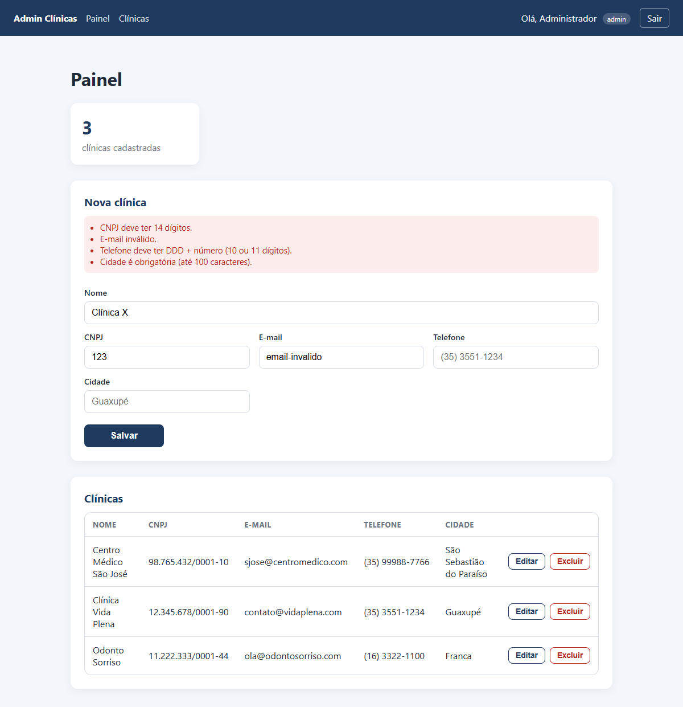
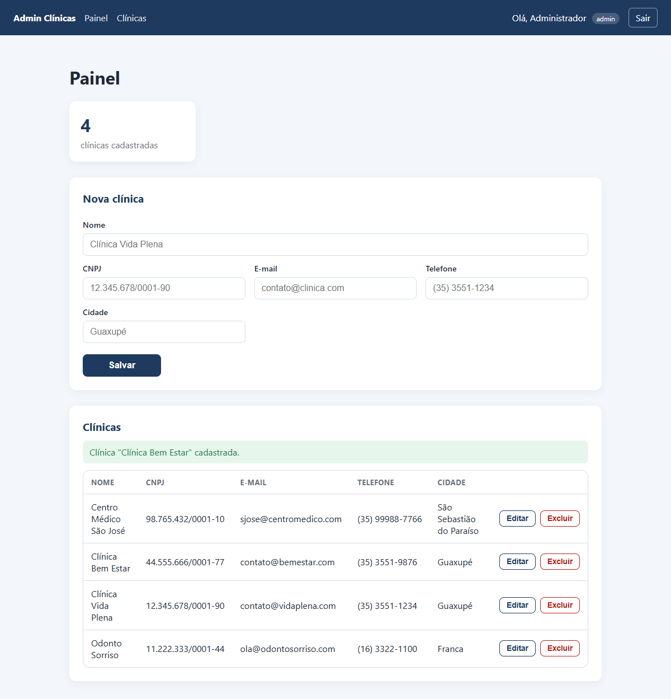
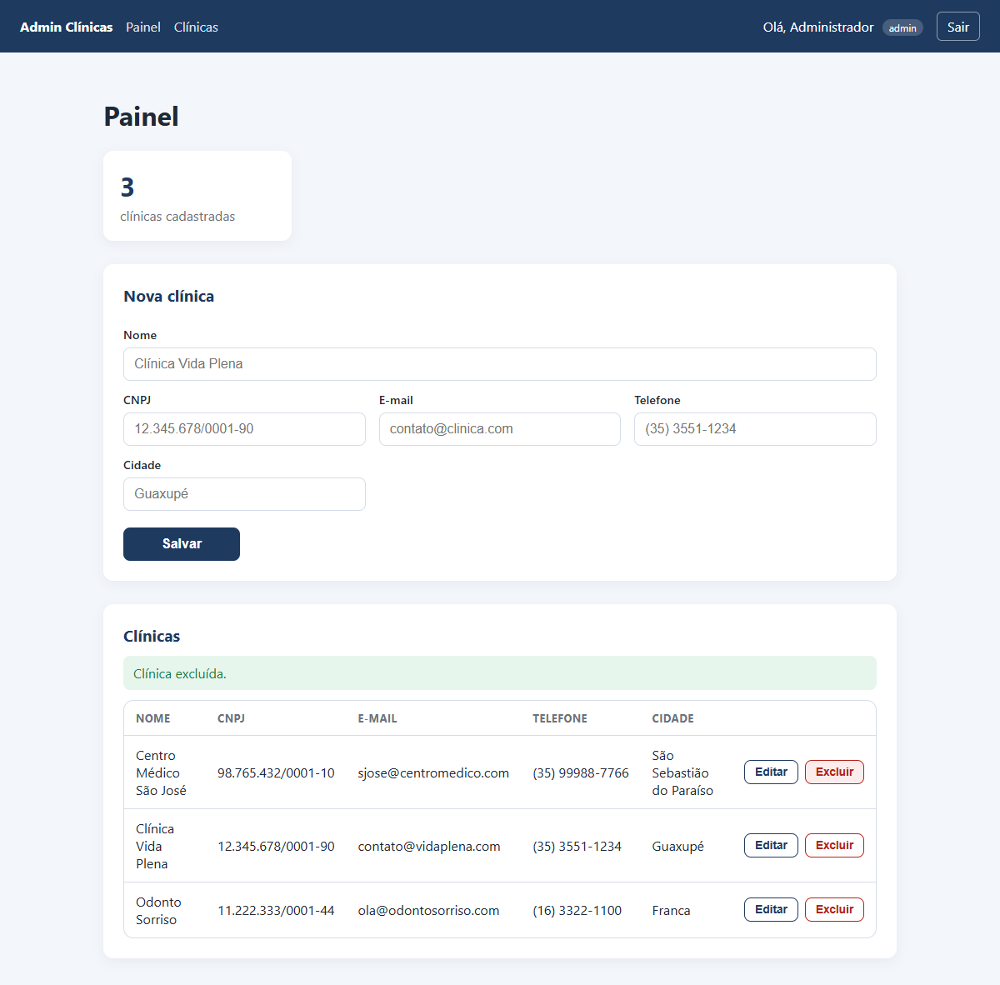

# Admin Clínicas

Painel administrativo em PHP para o app de clínicas — projeto da disciplina Linguagem de Programação VIII (UNIFEG).

- **Etapa 1:** cadastro, login com sessão, área protegida, logout e exclusão restrita ao admin (403).
- **Etapa 2:** API própria em JSON para as clínicas, protegida pela mesma sessão, com coleção do Postman.
- **Etapa 3:** interface em `painel.php` + `js/app.js` que consome a API com `fetch`: lista, cadastro, edição e exclusão, tratando cada status.

## Como rodar no XAMPP

1. Copie a pasta do projeto para `C:\xampp\htdocs\AdminPHP` (no macOS: `/Applications/XAMPP/htdocs/AdminPHP`).
2. Inicie o **Apache** e o **MySQL** no painel do XAMPP.
3. Abra o phpMyAdmin (`http://localhost/phpmyadmin`), vá na aba **SQL** e rode o conteúdo de `banco.sql`.
4. Acesse `http://localhost/AdminPHP`.

Se o seu MySQL tiver senha ou outra porta, crie `config/local.php` (fica fora do git):

```php
<?php
return ["usuario" => "root", "senha" => "sua_senha"];
```

### Sem XAMPP (servidor embutido do PHP)

```bash
mysql -u root -p < banco.sql
php -S localhost:8000
```

## Usuários de teste

| Perfil | E-mail | Senha |
|---|---|---|
| admin | admin@clinica.com | admin123 |
| usuario | maria@clinica.com | user123 |

Novos usuários criados em `cadastro.php` entram com perfil `usuario`.

## API

Base: `http://localhost/AdminPHP/api`. Todas as respostas são JSON (`Content-Type: application/json; charset=utf-8`).
A autenticação usa a sessão: depois do login, o cliente reenvia o cookie `PHPSESSID` automaticamente.

### Quadro de endpoints

| Método | URL | Ação | Sucesso | Erros possíveis |
|---|---|---|---|---|
| POST | `/api/login.php` | Entrar | 200 | 401, 405, 422 |
| POST | `/api/logout.php` | Sair | 204 | 405 |
| GET | `/api/me.php` | Usuário logado | 200 | 401 |
| GET | `/api/clinicas.php` | Listar clínicas | 200 | 401 |
| GET | `/api/clinicas.php?id=3` | Buscar clínica | 200 | 400, 401, 404 |
| POST | `/api/clinicas.php` | Criar clínica | 201 | 400, 401, 422 |
| PUT | `/api/clinicas.php?id=3` | Atualizar clínica | 200 | 400, 401, 404, 422 |
| DELETE | `/api/clinicas.php?id=3` | Excluir clínica (**admin**) | 204 | 400, 401, 403, 404 |
| outro | `/api/clinicas.php` | — | — | 405 |
| GET | `/api/dashboard.php` | Resumo do sistema (**admin**) | 200 | 401, 403, 405 |
| PUT | `/api/usuarios.php?id=4` | Tornar usuário admin (**admin**) | 200 | 400, 401, 403, 404, 405, 422 |

### Significado dos status

| Código | Quando |
|---|---|
| 200 | Consulta, atualização ou login bem-sucedidos |
| 201 | Clínica criada (corpo traz a clínica com o `id` novo) |
| 204 | Exclusão ou logout feitos (sem corpo) |
| 400 | JSON malformado ou `id` ausente/inválido na URL |
| 401 | Sem login, ou e-mail/senha inválidos no login |
| 403 | Logado, mas sem permissão (ex.: usuário comum tentando excluir) |
| 404 | Clínica inexistente |
| 405 | Método que o endpoint não trata |
| 422 | Dados inválidos — corpo traz `{"erros": [...]}` com todos os problemas |
| 500 | Erro interno ou banco fora do ar (sem detalhes técnicos) |

### Corpos

**Login** — `POST /api/login.php` (JSON ou `x-www-form-urlencoded`)

```json
{ "email": "admin@clinica.com", "senha": "admin123" }
```

**Clínica** — `POST` e `PUT /api/clinicas.php` (todos os campos obrigatórios)

```json
{
  "nome": "Clínica Vida Plena",
  "cnpj": "12.345.678/0001-90",
  "email": "contato@vidaplena.com",
  "telefone": "(35) 3551-1234",
  "cidade": "Guaxupé"
}
```

Regras (em `validarClinica()`, usada pela API): nome até 150 caracteres, CNPJ com 14 dígitos e único,
e-mail válido, telefone com DDD (10 ou 11 dígitos), cidade até 100 caracteres.
CNPJ e telefone podem vir com máscara; são gravados só com dígitos.

**Resposta de uma clínica**

```json
{
  "id": 1,
  "nome": "Clínica Vida Plena",
  "cnpj": "12345678000190",
  "email": "contato@vidaplena.com",
  "telefone": "3535511234",
  "cidade": "Guaxupé",
  "criado_em": "2026-11-11 10:00:00"
}
```

### Testando no Postman

1. **Import** → `postman/AdminClinicas.postman_collection.json`.
2. Se a pasta não for `AdminPHP`, ajuste a variável `baseUrl` da coleção.
3. Clique na coleção → **Run collection**. As pastas rodam na ordem: sem login (401), usuário comum (403),
   CRUD do admin (200/201/204), casos de erro (400/404/405/422) e logout.

O cookie de sessão é guardado pelo Postman entre as requisições, como faria o navegador.

## Interface (Etapa 3)

Depois do login, `painel.php` é a tela principal. O HTML fica na página e todo o comportamento
fica em `js/app.js`, que chama `api/clinicas.php` com `fetch` e `async/await`.

- **Mesma origem:** a página e a API estão no mesmo host e na mesma porta (`http://localhost/AdminPHP/...`).
  Por isso não há CORS e o cookie `PHPSESSID` vai junto em toda chamada, sem configuração.
- **Duas camadas de proteção:** a página usa `exigirLogin()` (redireciona) e a API usa `exigirLoginApi()` /
  `exigirPerfilApi("admin")` (responde 401/403 em JSON).
- **Status antes do corpo:** o `fetch` só falha sem rede; 401, 403, 404 e 422 chegam como respostas
  normais. O `app.js` confere `resp.status` / `resp.ok` antes de chamar `resp.json()`.
- **textContent:** todo dado vindo da API entra na tela com `textContent` (nunca `innerHTML`). Um nome como
  `<b>Teste</b>` aparece escrito, sem ser interpretado como HTML.

### Estados da tela

| Situação | Status | O que a tela faz |
|---|---|---|
| Carregando | — | Mostra "Carregando..." até a resposta chegar |
| Lista com dados | 200 | Desenha a tabela e atualiza o total |
| Lista vazia | 200 e `[]` | Mostra "Nenhuma clínica cadastrada." |
| Clínica criada / atualizada | 201 / 200 | Limpa o formulário, recarrega a lista e mostra mensagem de sucesso |
| Dados inválidos | 422 | Lista os erros do servidor acima do formulário |
| Sem login / sessão expirada | 401 | Leva para `login.php` |
| Sem permissão | 403 | Mostra "Você não tem permissão." |
| Não encontrado | 404 | Mostra "Registro não existe." e recarrega a lista |
| Clínica excluída | 204 | Recarrega a lista e mostra "Clínica excluída." |
| Sem rede ou servidor | exceção | Mostra "Servidor indisponível." |

O botão **Excluir** só aparece para o admin, mas quem protege a exclusão é o 403 da API. Para conferir,
entre como `maria@clinica.com`, abra o F12 → Console e rode `excluir(1)`: a tela mostra
"Você não tem permissão." e a aba Network mostra o `DELETE` com status 403.

### Dashboard do admin

`dashboard.php` é uma página **só para administradores**, com o resumo do sistema: total de clínicas,
cidades atendidas, usuários (administradores / comuns), um gráfico de clínicas por cidade, as últimas
clínicas cadastradas e a lista de usuários (sem o hash da senha).

| Quem acessa | `dashboard.php` (página) | `GET /api/dashboard.php` |
|---|---|---|
| Sem login | redireciona para `login.php` | 401 `{"erro": "Faça login."}` |
| Usuário comum | 403 "Acesso negado." (`exigirPerfil("admin")`) | 403 `{"erro": "Sem permissão."}` (`exigirPerfilApi("admin")`) |
| Admin | 200, a tela carrega os dados pela API | 200 com o resumo em JSON |

O link **Dashboard** no menu só aparece para o admin, mas quem protege é o servidor: um usuário comum
que digitar o endereço recebe 403. A tela segue as mesmas regras do `app.js` (status antes do corpo,
`textContent`, estados de carregando / 401 / 403 / servidor indisponível).

**Tornar admin:** na tabela de usuários, cada usuário comum tem o botão **Tornar admin**, que chama
`PUT /api/usuarios.php?id=4` com o corpo `{"perfil": "admin"}`. Só promove: qualquer outro perfil
responde 422. O perfil fica guardado na sessão no momento do login, então:

- quem foi promovido vira admin **a partir do próximo login** (precisa sair e entrar de novo);
- rebaixar não é oferecido, porque um admin rebaixado continuaria admin até a sessão acabar.

**Resposta de `GET /api/dashboard.php`**

```json
{
  "totais": { "clinicas": 15, "cidades": 7, "usuarios": 2, "admins": 1, "comuns": 1 },
  "por_cidade": [ { "cidade": "Guaxupé", "total": 4 } ],
  "ultimas_clinicas": [ { "id": 15, "nome": "Nutri Saúde", "cidade": "Passos", "...": "..." } ],
  "usuarios": [ { "id": 1, "nome": "Administrador", "email": "admin@clinica.com", "perfil": "admin", "criado_em": "..." } ]
}
```

### Prints das telas

| | |
|---|---|
|  Login |  Painel do admin (200) |
|  Dados inválidos (422) |  Clínica criada (201) |
|  Edição (PUT 200) |  Clínica excluída (204) |
|  Usuário comum: sem botão excluir e 403 |  Servidor indisponível |

## Estrutura

```
api/
  clinicas.php         GET/POST/PUT/DELETE de clínicas
  dashboard.php        resumo do sistema (só admin)
  login.php            login que responde JSON
  logout.php           logout que responde 204
  me.php               usuário da sessão
  usuarios.php         PUT para tornar um usuário admin (só admin)
config/conexao.php     conexão PDO
includes/
  api.php              responder(), lerJson(), exigirLoginApi(), exigirPerfilApi()
  auth.php             sessão, exigirLogin(), exigirPerfil()
  clinicas.php         SQL e validação das clínicas (usado por páginas e API)
  usuarios.php         inserirUsuario(), buscarUsuarioPorEmail(), autenticar(), listarUsuarios(), alterarPerfilUsuario()
  dashboard.php        resumoDashboard(): junta os números do dashboard
  topo.php             cabeçalho das páginas logadas
js/app.js              interface: fetch, estados da tela, formulário e exclusão
js/dashboard.js        dashboard do admin: fetch, cartões, gráfico, tabelas e "Tornar admin"
login.php              password_verify + session_regenerate_id
cadastro.php           password_hash
painel.php             interface protegida (exigirLogin) que consome a API
dashboard.php          dashboard só do admin (exigirPerfil("admin") → 403)
clinicas.php           listagem renderizada no servidor (Etapa 1)
excluir.php            exclusão restrita (exigirPerfil("admin") → 403)
logout.php             encerra a sessão
banco.sql              tabelas usuarios e clinicas + dados de exemplo
postman/               coleção do Postman exportada
docs/prints/           prints das telas
```
