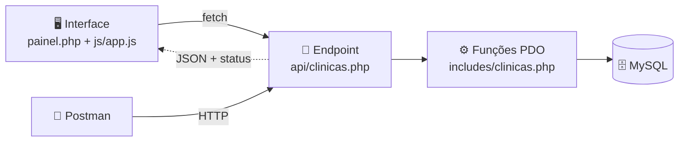
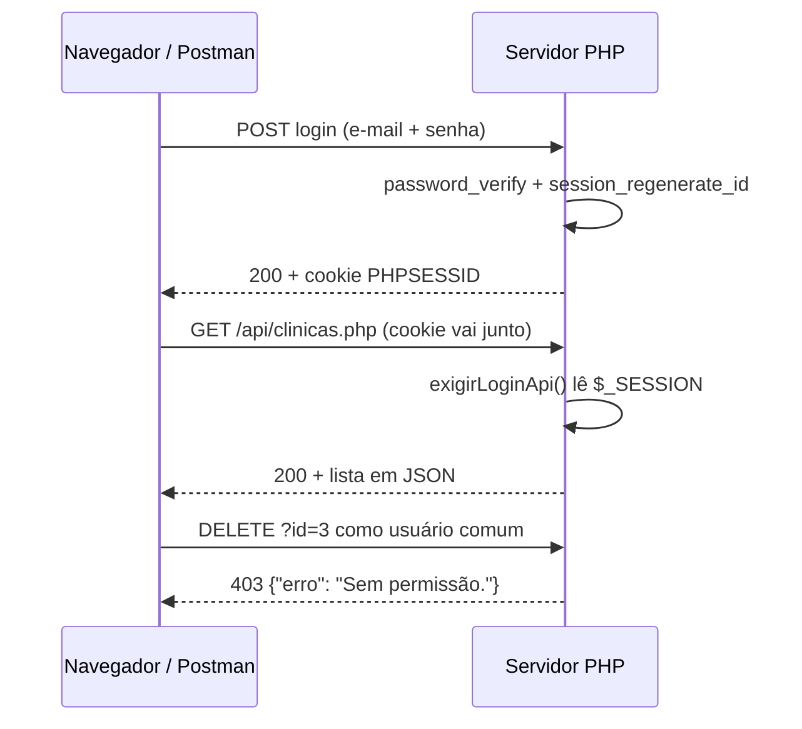
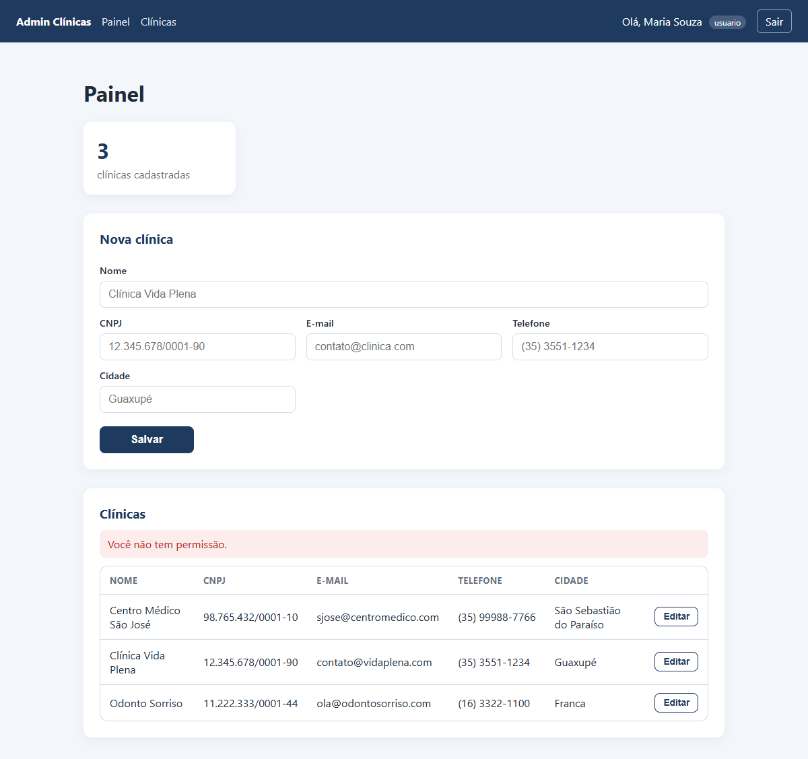

<div align="center">

# 🏥 Admin Clínicas

**Painel administrativo em PHP para o app de clínicas**

Login com sessão · API própria em JSON · Interface com `fetch` · Controle de acesso por perfil


*Linguagem de Programação VIII — UNIFEG · Ciência da Computação, 8º período*

</div>

---

## 📑 Sumário

1. [O que o projeto entrega](#-o-que-o-projeto-entrega)
2. [Como funciona](#-como-funciona)
3. [Como rodar](#-como-rodar)
4. [Testando no Postman](#-testando-no-postman)
5. [Roteiro da apresentação](#-roteiro-da-apresentação)
6. [API — referência](#-api--referência)
7. [Interface](#-interface)
8. [Segurança aplicada](#-segurança-aplicada)
9. [Estrutura de pastas](#-estrutura-de-pastas)

---

## ✅ O que o projeto entrega

O projeto foi construído em etapas, uma por exercício. Cada linha abaixo é um item conferido na correção.

### Etapa 1 — Login e área protegida

| Requisito | Como foi feito | Onde |
|---|---|---|
| Senha guardada com hash | `password_hash` no cadastro, `password_verify` no login | [`includes/usuarios.php`](includes/usuarios.php) |
| Páginas protegidas | `exigirLogin()` no topo de toda página restrita | [`includes/auth.php`](includes/auth.php) |
| Mensagem de login genérica | "E-mail ou senha inválidos." nos dois casos — o cadastro também não revela quem tem conta | [`login.php`](login.php), [`cadastro.php`](cadastro.php) |
| Ação restrita ao admin com 403 | `exigirPerfil("admin")` antes de excluir | [`excluir.php`](excluir.php), [`dashboard.php`](dashboard.php) |

### Etapa 2 — API própria

| Requisito | Como foi feito | Onde |
|---|---|---|
| Respostas sempre em JSON | `responder()` define o `Content-Type`; avisos do PHP desligados; erro inesperado vira 500 em JSON | [`includes/api.php`](includes/api.php) |
| Códigos de status corretos | 200, 201, 204, 400, 401, 403, 404, 405, 422 — cada um no seu caso | [`api/clinicas.php`](api/clinicas.php) |
| Validação reaproveitada | uma única `validarClinica()`, sem regra copiada | [`includes/clinicas.php`](includes/clinicas.php) |
| 401 e 403 em todos os endpoints | `exigirLoginApi()` e `exigirPerfilApi("admin")` | [`includes/api.php`](includes/api.php) |
| Coleção do Postman | 35 requisições com testes automáticos | [`postman/`](postman/AdminClinicas.postman_collection.json) |

### Etapa 3 — Interface

| Requisito | Como foi feito | Onde |
|---|---|---|
| Interface consome a API | `fetch` + `async/await` para listar, criar, editar e excluir | [`js/app.js`](js/app.js) |
| Estados da tela | carregando, lista, vazio, erro, sucesso, sem permissão, servidor fora | [`js/app.js`](js/app.js) |
| Status antes do corpo | confere `resp.status` antes de `resp.json()` | [`js/app.js`](js/app.js) |
| Dashboard do admin | totais, gráfico por cidade, últimos cadastros e "Tornar admin" | [`dashboard.php`](dashboard.php), [`js/dashboard.js`](js/dashboard.js) |

---

## 🧭 Como funciona

### Camadas

A tela não fala com o banco: ela chama a API, que chama as funções PHP, que fazem o SQL. Cada camada tem uma responsabilidade só.



### Login e sessão

O HTTP não guarda estado. Depois do login, o servidor guarda o usuário na sessão e o navegador (ou o Postman) reenvia só o cookie `PHPSESSID`.



### Autenticação × autorização

| Pergunta | Falhou na página | Falhou na API |
|---|---|---|
| **Quem é você?** (autenticação) | redireciona para `login.php` | `401 {"erro": "Faça login."}` |
| **Você pode fazer isso?** (autorização) | `403 Acesso negado.` | `403 {"erro": "Sem permissão."}` |

---

## 🚀 Como rodar

> Pré-requisito: **XAMPP** com Apache e MySQL.

1. Copie a pasta do projeto para `htdocs/AdminPHP`
   (Windows: `C:\xampp\htdocs\AdminPHP` · macOS: `/Applications/XAMPP/htdocs/AdminPHP`).
2. No painel do XAMPP, inicie o **Apache** e o **MySQL**.
3. Abra `http://localhost/phpmyadmin`, aba **SQL**, cole o conteúdo de [`banco.sql`](banco.sql) e execute.
4. Acesse **`http://localhost/AdminPHP`** e entre com um dos usuários abaixo.

### 👤 Usuários de teste

| Perfil | E-mail | Senha | Pode |
|---|---|---|---|
| 🛡️ admin | `admin@clinica.com` | `admin123` | tudo, inclusive excluir, ver o dashboard e promover usuários |
| 👩 usuario | `maria@clinica.com` | `user123` | listar, criar e editar clínicas |

Quem se cadastra em `cadastro.php` entra como `usuario`.

<details>
<summary><b>MySQL com senha ou sem XAMPP</b></summary>

Se o MySQL tiver senha ou outra porta, crie `config/local.php` (fica fora do git):

```php
<?php
return ["usuario" => "root", "senha" => "sua_senha"];
```

Para rodar sem XAMPP, com o servidor embutido do PHP:

```bash
mysql -u root -p < banco.sql
php -S localhost:8000
```

</details>

---

## 🧪 Testando no Postman

A coleção [`postman/AdminClinicas.postman_collection.json`](postman/AdminClinicas.postman_collection.json) tem **35 requisições** e **94 testes automáticos**. **Cada pasta funciona sozinha**: as que precisam de login já começam fazendo o login, então dá para demonstrar qualquer parte sem rodar as anteriores.

### Em 3 passos

1. **Importar** — no Postman, clique em **Import** e arraste o arquivo da pasta `postman/`.
2. **Conferir o endereço** — se a pasta no XAMPP não for `AdminPHP`, abra a coleção → aba **Variables** → ajuste `baseUrl`.
3. **Rodar** — nos `...` da coleção, clique em **Run** → **Run API Admin Clínicas**. Os testes devem ficar todos verdes ✅.

Para mostrar ao vivo, abra uma pasta e clique em **Send** em cada requisição, de cima para baixo. O nome de cada requisição já diz o status esperado, e a aba **Docs** explica o que ela demonstra.

### O que cada pasta mostra

| Pasta | O que demonstra | Status |
|---|---|---|
| **1. Sem login → 401** | Nada abre sem login. Senha errada e e-mail inexistente recebem a **mesma** mensagem | `401` |
| **2. Usuária comum → 403** | Maria lista clínicas, mas não exclui, não abre o dashboard e não se promove | `200` `403` |
| **3. Admin → CRUD de clínicas** | Criar → buscar → atualizar → excluir a mesma clínica | `200` `201` `204` |
| **4. Admin → dashboard e usuários** | Resumo do sistema (sem hash de senha) e "Tornar admin" | `200` |
| **5. Admin → casos de erro** | Id inexistente, id inválido, dados inválidos, CNPJ repetido, JSON quebrado, método errado | `400` `404` `405` `422` |
| **6. Sair** | Depois do logout a API volta a pedir login | `204` `401` |

> 💡 Os testes **não mudam os dados de exemplo**: a clínica criada na pasta 3 é excluída no fim dela, o CNPJ é sorteado a cada execução e o "Tornar admin" usa o próprio admin. Dá para rodar quantas vezes quiser.

<details>
<summary><b>Rodar os testes pelo terminal (newman)</b></summary>

Com o Node instalado, roda a coleção inteira sem abrir o Postman:

```bash
npx newman run postman/AdminClinicas.postman_collection.json
```

Se o endereço for outro:

```bash
npx newman run postman/AdminClinicas.postman_collection.json --env-var "baseUrl=http://localhost:8000/api"
```

Só uma pasta:

```bash
npx newman run postman/AdminClinicas.postman_collection.json --folder "5. Admin → casos de erro"
```

</details>

---

## 🎤 Roteiro da apresentação

Sugestão de ordem para mostrar tudo em poucos minutos:

| # | Mostrar | Onde | O que destacar |
|---|---|---|---|
| 1 | Senha errada e e-mail inexistente | tela de login | mesma mensagem nos dois casos |
| 2 | Coluna `senha_hash` | phpMyAdmin | a senha digitada não aparece no banco |
| 3 | Entrar como **admin** e criar uma clínica com erro, depois certa | painel | 422 lista os erros; 201 atualiza a lista |
| 4 | Editar e excluir | painel | PUT 200 e DELETE 204 |
| 5 | Dashboard e "Tornar admin" | dashboard | só o admin vê o menu |
| 6 | Entrar como **Maria** | painel | sem botão Excluir; digitar `dashboard.php` dá 403 |
| 7 | Rodar a coleção | Postman | 94 testes verdes, cada status no seu caso |
| 8 | Pasta **2. Usuária comum → 403** | Postman | a proteção está no servidor, não só na tela |

---

## 📡 API — referência

Base: `http://localhost/AdminPHP/api` · Todas as respostas são JSON · A autenticação usa o cookie de sessão `PHPSESSID`.

### Quadro de endpoints

| Método | URL | Ação | Sucesso | Erros possíveis |
|---|---|---|---|---|
| `POST` | `/api/login.php` | Entrar | 200 | 401, 405, 422 |
| `POST` | `/api/logout.php` | Sair | 204 | 405 |
| `GET` | `/api/me.php` | Usuário logado | 200 | 401 |
| `GET` | `/api/clinicas.php` | Listar clínicas | 200 | 401 |
| `GET` | `/api/clinicas.php?id=3` | Buscar clínica | 200 | 400, 401, 404 |
| `POST` | `/api/clinicas.php` | Criar clínica | 201 | 400, 401, 422 |
| `PUT` | `/api/clinicas.php?id=3` | Atualizar clínica | 200 | 400, 401, 404, 422 |
| `DELETE` | `/api/clinicas.php?id=3` | Excluir clínica 🛡️ | 204 | 400, 401, 403, 404 |
| `GET` | `/api/dashboard.php` | Resumo do sistema 🛡️ | 200 | 401, 403, 405 |
| `PUT` | `/api/usuarios.php?id=4` | Tornar usuário admin 🛡️ | 200 | 400, 401, 403, 404, 405, 422 |

🛡️ = só administrador · Qualquer método não tratado responde **405**.

### Significado dos status

| Código | Quando |
|---|---|
| 🟢 `200` | Consulta, atualização ou login bem-sucedidos |
| 🟢 `201` | Clínica criada — o corpo traz a clínica com o `id` novo |
| 🟢 `204` | Exclusão ou logout feitos — sem corpo |
| 🟠 `400` | JSON malformado ou `id` ausente/inválido na URL |
| 🔴 `401` | Sem login, ou e-mail/senha inválidos no login |
| 🔴 `403` | Logado, mas sem permissão |
| 🟠 `404` | Registro inexistente |
| 🟠 `405` | Método que o endpoint não trata |
| 🟠 `422` | Dados inválidos — `{"erros": [...]}` com todos os problemas |
| ⚫ `500` | Erro interno ou banco fora do ar — sem detalhes técnicos |

<details>
<summary><b>Corpos de requisição e resposta</b></summary>

**Login** — `POST /api/login.php` (JSON ou `x-www-form-urlencoded`)

```json
{ "email": "admin@clinica.com", "senha": "admin123" }
```

**Clínica** — `POST` e `PUT /api/clinicas.php` (todos os campos obrigatórios)

```json
{
  "nome": "Clínica Vida Plena",
  "cnpj": "12.345.678/0001-90",
  "email": "contato@vidaplena.com",
  "telefone": "(35) 3551-1234",
  "cidade": "Guaxupé"
}
```

Regras de `validarClinica()`: nome até 150 caracteres, CNPJ com 14 dígitos e único, e-mail válido,
telefone com DDD (10 ou 11 dígitos), cidade até 100 caracteres. CNPJ e telefone podem vir com máscara
e são gravados só com dígitos.

**Resposta de uma clínica**

```json
{
  "id": 1,
  "nome": "Clínica Vida Plena",
  "cnpj": "12345678000190",
  "email": "contato@vidaplena.com",
  "telefone": "3535511234",
  "cidade": "Guaxupé",
  "criado_em": "2026-11-11 10:00:00"
}
```

**Dados inválidos (422)**

```json
{ "erros": ["CNPJ deve ter 14 dígitos.", "E-mail inválido."] }
```

**Tornar admin** — `PUT /api/usuarios.php?id=4`

```json
{ "perfil": "admin" }
```

**Resposta de `GET /api/dashboard.php`**

```json
{
  "totais": { "clinicas": 15, "cidades": 7, "usuarios": 2, "admins": 1, "comuns": 1 },
  "por_cidade": [ { "cidade": "Guaxupé", "total": 4 } ],
  "ultimas_clinicas": [ { "id": 15, "nome": "Nutri Saúde", "cidade": "Passos", "...": "..." } ],
  "usuarios": [ { "id": 1, "nome": "Administrador", "email": "admin@clinica.com", "perfil": "admin", "criado_em": "..." } ]
}
```

</details>

---

## 🖥️ Interface

Depois do login, `painel.php` é a tela principal. O HTML fica na página e todo o comportamento fica em `js/app.js`, que chama a API com `fetch`.

### Telas

| | |
|---|---|
|  **Login** |  **Painel do admin** (200) |
|  **Dados inválidos** (422) |  **Clínica criada** (201) |
|  **Edição** (PUT 200) |  **Clínica excluída** (204) |
|  **Usuário comum**: sem botão excluir e 403 |  **Servidor indisponível** |

### Estados da tela

| Situação | Status | O que a tela faz |
|---|---|---|
| ⏳ Carregando | — | Mostra "Carregando..." até a resposta chegar |
| 📋 Lista com dados | 200 | Desenha a tabela e atualiza o total |
| 📭 Lista vazia | 200 e `[]` | Mostra "Nenhuma clínica cadastrada." |
| ✅ Criada / atualizada | 201 / 200 | Limpa o formulário, recarrega a lista e mostra sucesso |
| ⚠️ Dados inválidos | 422 | Lista os erros do servidor acima do formulário |
| 🔑 Sem login / sessão expirada | 401 | Leva para `login.php` |
| 🚫 Sem permissão | 403 | Mostra "Você não tem permissão." |
| ❓ Não encontrado | 404 | Mostra "Registro não existe." e recarrega a lista |
| 🗑️ Excluída | 204 | Recarrega a lista e mostra "Clínica excluída." |
| 📡 Sem rede ou servidor | exceção | Mostra "Servidor indisponível." |

<details>
<summary><b>Detalhes da interface e do dashboard</b></summary>

- **Mesma origem:** a página e a API estão no mesmo host e porta (`http://localhost/AdminPHP/...`), por isso não há CORS e o cookie `PHPSESSID` vai junto em toda chamada.
- **Status antes do corpo:** o `fetch` só falha sem rede; 401, 403, 404 e 422 chegam como respostas normais. O `app.js` confere `resp.status` / `resp.ok` antes de chamar `resp.json()`.
- **`textContent`:** todo dado vindo da API entra na tela com `textContent` (nunca `innerHTML`). Um nome como `<b>Teste</b>` aparece escrito, sem virar HTML.
- **Botão escondido não protege:** entre como `maria@clinica.com`, abra o F12 → Console e rode `excluir(1)`. A tela mostra "Você não tem permissão." e a aba Network mostra o `DELETE` com 403.

**Dashboard do admin** (`dashboard.php`): total de clínicas, cidades atendidas, usuários (admins / comuns), gráfico de clínicas por cidade, últimas clínicas e lista de usuários sem o hash da senha.

| Quem acessa | `dashboard.php` (página) | `GET /api/dashboard.php` |
|---|---|---|
| Sem login | redireciona para `login.php` | 401 |
| Usuário comum | 403 "Acesso negado." | 403 |
| Admin | 200, a tela carrega os dados pela API | 200 com o resumo |

**Tornar admin:** cada usuário comum tem o botão **Tornar admin**, que chama `PUT /api/usuarios.php?id=4` com `{"perfil": "admin"}`. Só promove; qualquer outro perfil responde 422. Como o perfil fica guardado na sessão no momento do login, quem foi promovido vira admin **a partir do próximo login**. Rebaixar não é oferecido, porque um admin rebaixado continuaria admin até a sessão acabar.

</details>

---

## 🔒 Segurança aplicada

| Cuidado | Como |
|---|---|
| Senha nunca em texto puro | `password_hash` / `password_verify`; o hash nunca sai em nenhuma resposta |
| Fixação de sessão | `session_regenerate_id(true)` logo após o login |
| Cookie de sessão protegido | `HttpOnly` e `SameSite=Lax` |
| Não revelar quem tem conta | mensagem genérica no login e no cadastro |
| SQL injection | só prepared statements com PDO |
| XSS | `htmlspecialchars` no PHP (função `e()`) e `textContent` no JavaScript |
| Proteção no servidor | toda página e todo endpoint confere login e perfil — esconder botão é só conforto visual |
| Logout de verdade | esvazia a sessão, apaga o cookie e destrói a sessão; a página logada não fica em cache |
| Erros sem vazar detalhes | falha de banco ou exceção vira 500 com mensagem genérica |

---

## 📁 Estrutura de pastas

```
AdminPHP/
├── api/                     ← endpoints JSON (Etapa 2)
│   ├── clinicas.php         GET / POST / PUT / DELETE de clínicas
│   ├── dashboard.php        resumo do sistema (só admin)
│   ├── login.php            login que responde JSON
│   ├── logout.php           logout que responde 204
│   ├── me.php               usuário da sessão
│   └── usuarios.php         PUT para tornar um usuário admin (só admin)
├── config/
│   └── conexao.php          conexão PDO
├── includes/                ← funções reaproveitadas por páginas e API
│   ├── api.php              responder(), lerJson(), exigirLoginApi(), exigirPerfilApi()
│   ├── auth.php             sessão, exigirLogin(), exigirPerfil()
│   ├── clinicas.php         SQL e validação das clínicas
│   ├── dashboard.php        resumoDashboard()
│   ├── usuarios.php         cadastro, login e perfil dos usuários
│   └── topo.php             cabeçalho das páginas logadas
├── js/                      ← interface (Etapa 3)
│   ├── app.js               fetch, estados da tela, formulário e exclusão
│   └── dashboard.js         dashboard do admin e "Tornar admin"
├── login.php · cadastro.php · logout.php        ← Etapa 1
├── painel.php               interface protegida que consome a API
├── dashboard.php            dashboard só do admin (403 para os demais)
├── clinicas.php · excluir.php                    listagem e exclusão renderizadas no servidor
├── banco.sql                tabelas + dados de exemplo
├── postman/                 coleção do Postman
└── docs/prints/             prints das telas
```
